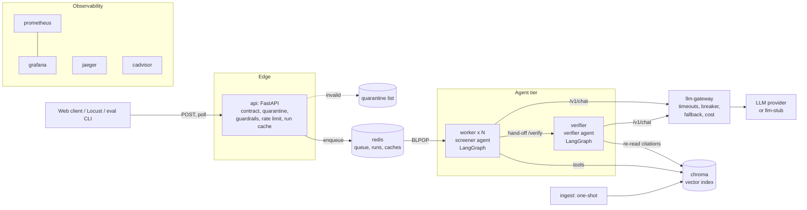

# Architecture and deployment boundaries (D3)

## Request lifecycle

1. `POST /v1/screenings`. The API checks, cheapest first: rate limit → JSON →
   data contract → input guardrails → whole-run cache. Any rejection is
   quarantined with field-level errors; no run ID exists, so no agent runs.
2. A run record is created in Redis and the job is queued. The API returns
   `202 {run_id}` immediately (runs take tens of seconds).
3. A worker takes the job and runs the screener graph. The screener LLM picks
   tools (corpus search, clause lookup, request-field lookup) until it drafts
   an answer.
4. The worker hands the draft to the verifier service. Pass → output filter →
   result. Fail → one retry with the verifier's strategy, else escalation.
5. Every step is written to the run record as it happens. `GET
   /v1/screenings/{id}/trace` returns the full reconstruction; Jaeger shows the
   same run as one trace (search tag `run_id`).

## Why each boundary is where it is

| Service | Scaling | Failure isolation | Independent release | Resource profile |
| --- | --- | --- | --- | --- |
| api | Scales with request rate, not run rate | A slow model never blocks submission or polling | Contract changes ship without touching agents | Light, I/O bound |
| worker | **The service we scale** (`--scale worker=3`); one run per replica | A crashed run kills one replica's job, not the API | Agent logic and prompts ship alone | CPU for query embeddings, long-lived |
| verifier | Scales separately if verification becomes the bottleneck | If it is down, runs escalate instead of returning unverified answers (A2, A3) | Verification rules ship without redeploying workers | Light; one LLM call per run |
| llm-gateway | One instance holds one breaker state for all workers | Provider outages stop at one place; workers see one clean error | Provider and model change by config only (section 12) | I/O bound, async |
| llm-stub | Only for load tests | n/a | n/a | Tiny |
| chroma | Stateful; not scaled | Index survives agent restarts | Re-index without redeploying | Memory and disk |
| redis | Single instance | Holds queue and state; AOF persistence | n/a | Memory |
| ingest | One-shot, runs on `up` | A failed ingest blocks workers from starting on a bad index | Corpus updates are a re-run, not a release | Burst CPU |

**Rejected alternatives**

- *Celery / RQ instead of a Redis list.* More machinery than one job type needs;
  BLPOP gives at-most-once FIFO with any number of consumers.
- *Verifier as a second prompt inside the worker.* The brief says two prompts in
  one process are not two agents, and a separate service gives a real hand-off
  with a failure mode we can show (stop the container → runs escalate).
- *Workers calling the provider directly.* Each replica would keep its own
  breaker, so N workers would hammer a dead provider N times longer, and
  switching provider would mean redeploying agents.
- *Synchronous API.* A 20–60 s request ties up a connection, times out behind
  proxies, and cannot be retried safely.
- *sentence-transformers with torch.* Same model (all-MiniLM-L6-v2), but the
  ONNX build that ships with Chroma keeps the image hundreds of MB smaller.

One image serves every application container; only the command differs. It
is built once and every boundary runs identical code.
